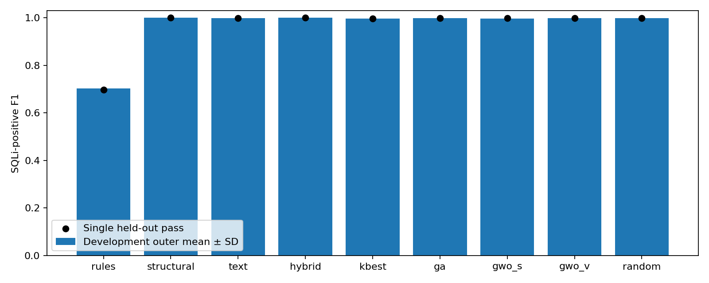

# SQL Injection Detection Lab

[](https://github.com/Ehsan-Rezaeii/sqli-detection-lab/actions/workflows/ci.yml)

**A reproducible research prototype for classifying SQL-injection-like HTTP parameter values.** The study compares hand-written rules, **20 structural features**, character n-gram TF-IDF, a hybrid representation, simple feature filtering, and **Binary GA/GWO feature selection**. A small **FastAPI** application demonstrates local inference with a frozen model.

**Research question:** How much do different representations and binary feature selectors contribute to detecting source-labeled SQLi-like strings under a controlled evaluation protocol—and what can these results *not* establish about real-world attacks?

**Main finding:** On a 6,032-item held-out split, the **structural (20-dimensional)** and **hybrid (40,020-dimensional)** models both achieved **F1 = 0.999768**, with **one false positive and zero false negatives**. The hybrid model was selected *before* test evaluation using development CV, but its identical holdout confusion counts do not demonstrate an improvement over structural features. The strikingly high scores are subject to **serious data-source confounding**; they are **not** evidence of deployable SQL injection prevention or generalization to new attack sources.

> **Research prototype, not a WAF or security control.** This project never executes SQL, connects to a database, scans targets, or tests whether a string can exploit an application. Use parameterized queries and other [OWASP SQL injection defenses](https://cheatsheetseries.owasp.org/cheatsheets/SQL_Injection_Prevention_Cheat_Sheet.html) to prevent SQL injection.

## Measured results

The pinned source provides **30,156 labeled values** for the binary experiment: **24,124 development** and **6,032 held-out**. The positive class is the source label `sqli`; `norm` is negative. The following values are from the **one frozen held-out evaluation**, not averaged development scores.

| Method | Input dimensions | F1 | Recall | Precision | AP | FP / FN |
|---|---:|---:|---:|---:|---:|---:|
| Fixed rules | — | 0.696731 | 0.534603 | 1.000000 | N/A | 0 / 1,002 |
| **Structural LR** | **20** | **0.999768** | **1.000000** | **0.999536** | 0.999999 | **1 / 0** |
| Character TF-IDF LR | 40,000 | 0.999070 | 0.998142 | 1.000000 | 0.999978 | 0 / 4 |
| **Hybrid LR** | **40,020** | **0.999768** | **1.000000** | **0.999536** | 1.000000 | **1 / 0** |
| SelectKBest (k=8) | 8 | 0.997212 | 0.996749 | 0.997675 | 0.999967 | 5 / 7 |
| Binary GA | 7 | 0.998837 | 0.997678 | 1.000000 | 1.000000 | 0 / 5 |
| Binary GWO-S | 6 | 0.997673 | 0.995820 | 0.999534 | 0.999955 | 1 / 9 |
| Binary GWO-V | 5 | 0.998373 | 0.997678 | 0.999070 | 0.999933 | 2 / 5 |
| Binary Random Search | 8 | 0.998605 | 0.997678 | 0.999535 | 0.999985 | 1 / 5 |

*LR = Logistic Regression; AP = Average Precision; FP/FN = false positives/false negatives at the fixed 0.5 threshold. Input dimensions refer to model representations, not necessarily independently informative variables. Rule-based predictions have no AP score.*



**How to interpret the comparison:**

- **Representation matters:** a 20-feature structural model matched the 40,020-dimensional hybrid model's holdout confusion matrix. This is not proof that their per-item probability estimates or performance under distribution shift are equivalent.
- **Feature selection reduced dimensionality, but not errors:** Binary GWO-V retained **5 of 20 structural features**; GA retained **7**, and GWO-S **6**. None beat the unselected structural baseline on held-out F1.
- **The demo model was not chosen from test scores:** hybrid had the highest mean outer-development F1 (**0.999655**, versus **0.999482** for structural), so the predeclared selection rule kept it even though both produced the same final confusion counts.
- **High numbers need context:** benign values originate from CSIC material while malicious examples were generated with sqlmap. Models may recognize generator-specific patterns rather than broadly detecting exploitable SQL injection.

See [all results, development variability, full confusion matrices, masks, timing and stress tests](docs/RESULTS.md), or inspect the [held-out confusion figure](results/plots/confusion.png) and [search convergence figure](results/plots/convergence.png).

## Experimental methodology

The [predefined protocol](docs/EXPERIMENT_PROTOCOL.md) distinguishes development, feature selection and final scoring:

1. **Data:** The repository uses a pinned revision of [Morzeux/HttpParamsDataset](https://github.com/Morzeux/HttpParamsDataset). Only `norm` and `sqli` source categories enter the binary study; other attack categories are excluded. Actual source bytes and SHA-256 are documented in [data provenance](docs/DATA_PROVENANCE.md). Raw values are not committed.
2. **Splits and leakage safeguards:** One held-out partition is reserved using five-way `StratifiedGroupKFold` (seed `2027`). Its development complement is evaluated with **three outer group-aware folds**, each using **three inner folds** for search. Groups use a canonicalized string representation; fitting the scaler, filters and TF-IDF vocabulary is restricted to the respective training folds.
3. **Representations and baselines:** 20 fixed structural counts/ratios; character **2–5-gram TF-IDF** (`max_features=40,000`); their sparse hybrid; `SelectKBest(f_classif, k=8)`; and explicit rule-based heuristics. Logistic Regression uses `solver="liblinear"`, `C=1`, `max_iter=1000`, `random_state=2030`, and threshold `0.5`.
4. **Search methods:** Binary GA, Binary GWO-S, Binary GWO-V and binary Random Search are imported directly from [metaheuristics-lab at commit `6b4ef0f`](https://github.com/Ehsan-Rezaeii/metaheuristics-lab/tree/6b4ef0fa3d72f608146f3dd7eabb84bf39fa896e)—not copied into this project. Each search uses **population 12** and exactly **60 objective evaluations**. An empty mask receives a fixed penalty; nonempty and repeated masks count toward the budget without a fitness cache.
5. **Objective and selection:** The search minimizes a predefined combination of inner-fold F1, false-positive rate, recall and selected-feature fraction. The local API's **hybrid** demo was selected by development-only outer F1, then FPR and method-name tie-breaks. Final masks, trained pipelines and relevant hashes were committed and frozen **before** test scoring.
6. **Evidence:** All **nine** methods were evaluated once using the same held-out partition. The **24 optimizer searches** consumed **1,440 objective calls** and **4,320 search classifier fits**. The reported study-wide total was **4,361 classifier fits**, including development baselines and sensitivity analyses; final scoring reused frozen models and performed **zero additional fits**.

The development-only grouping stress test reduced apparent template similarity but did not produce an independent, source-separated dataset. It is a sensitivity check—not evidence of deployment robustness. Complete split definitions, search traces and selected masks are available through [measured results](docs/RESULTS.md) and [saved artifacts](results/development/).

## Install and verify

**Requirements:** Python 3.10+ and Git. GitHub Actions verifies Python **3.10, 3.12 and 3.13**. Network access is needed initially for the pinned Git dependency.

```bash
git clone https://github.com/Ehsan-Rezaeii/sqli-detection-lab.git
cd sqli-detection-lab
python -m venv .venv
source .venv/bin/activate
python -m pip install -e '.[dev]'

ruff check .
ruff format --check .
pytest -q --cov=sqli_detection_lab
sqli-lab smoke
sqli-lab audit --require-final
python -m build
```

The synthetic smoke test does **not** download the dataset or recreate the measured experiment. The committed study passed **20 tests with 93% statement coverage** in its final verification; lint/format, a saved-artifact audit, source/wheel packaging and clean wheel import were also verified. The [main-branch CI workflow](https://github.com/Ehsan-Rezaeii/sqli-detection-lab/actions/workflows/ci.yml) completed successfully on all three Python versions. See [verification evidence](docs/VERIFICATION.md) for commands and recorded results.

## Run the local FastAPI demonstration

The service loads a **trusted, committed frozen hybrid pipeline** for inference. From the repository root, after installing dependencies:

```bash
sqli-lab audit --require-final
uvicorn sqli_detection_lab.api:create_app --factory --host 127.0.0.1 --port 8000 --no-access-log
```

In a second terminal, send a harmless test string:

```bash
curl --silent --show-error http://127.0.0.1:8000/health
curl --silent --show-error -X POST http://127.0.0.1:8000/predict \
  -H 'content-type: application/json' \
  -d '{"value":"example catalogue item"}'
```

`POST /predict` accepts one JSON string field named `value` (maximum **2,048 characters**). It returns a source-label classification (`norm` or `sqli`), a positive-class score, the model identifier and an experimental-use warning. Invalid request types, extra fields and oversized strings produce HTTP `422`; missing/untrusted frozen artifacts produce `503`. The request text is not logged by application code, and startup/prediction never trains a model, executes a payload, queries a database or fetches a URL.

**Security boundary:** The demo is loopback-only and has no production authentication, rate limiting or adversarial robustness guarantee. `joblib` can execute code while deserializing; load **only artifacts from a trusted checkout** after validating the frozen hashes. Hashes protect accidental changes, not an attacker who can replace the model and manifest together. Do not deploy this classifier as a request-blocking SQL injection defense.

## Reproduce and audit the study

The checked-in [`results/`](results/) directory contains the completed, frozen evidence. **Do not delete its start/completion markers or overwrite it to make a repeated held-out evaluation appear new.** Artifact auditing and the local API require no raw dataset.

For an independent computational reproduction, work in a **separate, clearly identified pre-final study history** rather than running `development`, `freeze` or `final` over the finalized checkout. The documented staging sequence is:

`acquire` → `prepare` → `development` → development verification and commit → `freeze` → commit and push the freeze → one `final` pass → artifact audit/report.

These are separate `sqli-lab` CLI commands except for the Git commits and reporting scripts. The final stage verifies a clean source checkout, frozen model/evidence identities, and the pushed freeze. Refer to the [exact recorded commands](docs/VERIFICATION.md), [experiment protocol](docs/EXPERIMENT_PROTOCOL.md) and [project specification](docs/PROJECT_SPEC.md) before attempting a reproduction. Such a rerun is **not** a new independent real-world validation.

## Limitations and research integrity

- **Source/generator confounding is the central limitation.** Benign CSIC-derived values and sqlmap-generated SQLi strings do not represent diverse real applications or independently verified attacks. Even almost-perfect held-out F1 cannot establish operational SQLi detection accuracy.
- **Residual similarity:** Canonical groups were disjoint, but stronger payload-template or generator similarity may cross splits. Stress-grouping is a useful diagnostic, not a substitute for source-separated evaluation.
- **Uncovered input regimes:** The held-out set contains **zero percent-encoded values**, so there is no measured generalization evidence for that stratum. The labels describe dataset categories, not successful exploitability.
- **Finite budgets and feature semantics:** Three correlated development folds and three search seeds cannot establish statistical superiority. A selected structural feature can be constant or redundant; smaller masks do not automatically imply more informative or more robust models.
- **Practical and legal constraints:** Runtime/memory observations are local measurements, not production throughput. Constituent data redistribution rights remain uncertain; raw payloads and source-row-aligned labels are excluded. The MIT code license does not clear third-party dataset rights.

## Documentation and portfolio context

| Resource | What it provides |
|---|---|
| [Measured results](docs/RESULTS.md) | Nine-method results, subgroup analyses, runtime, masks and limitations |
| [Experimental protocol](docs/EXPERIMENT_PROTOCOL.md) | Fixed splits, representations, optimizer budgets, objective and freeze rules |
| [Data provenance](docs/DATA_PROVENANCE.md) | Pinned source, checksums, generator limitations and data rights |
| [Verification](docs/VERIFICATION.md) | Commands, tests, coverage, GitHub Actions and evidence checks |
| [Implementation walkthrough](docs/IMPLEMENTATION_WALKTHROUGH.md) | Source code organization, modeling decisions and FastAPI behavior |
| [Study artifacts](results/) | Frozen models, audit reports, score histograms, masks and plots |

This is the **security-oriented classification application** in a five-project research portfolio. It reuses [Metaheuristics Lab](https://github.com/Ehsan-Rezaeii/metaheuristics-lab) as an installed optimization dependency. The other applications study [breast cancer feature selection](https://github.com/Ehsan-Rezaeii/breast-cancer-feature-selection), [software defect prediction on Apache Camel](https://github.com/Ehsan-Rezaeii/software-defect-prediction), and [search-based test generation](https://github.com/Ehsan-Rezaeii/search-based-test-generation). Their datasets, objectives and metrics are different; results should not be compared as if they measured the same task.

**License:** [MIT](LICENSE) for original project code. Upstream algorithms, data and publications retain their own attribution and rights.
