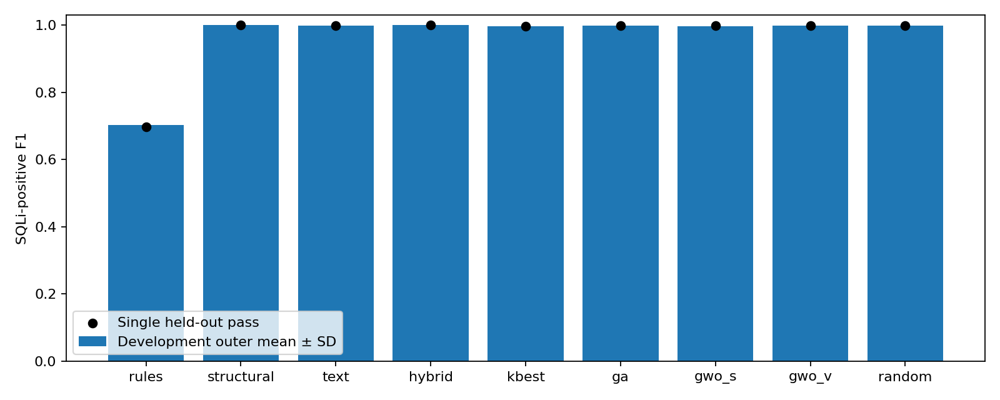
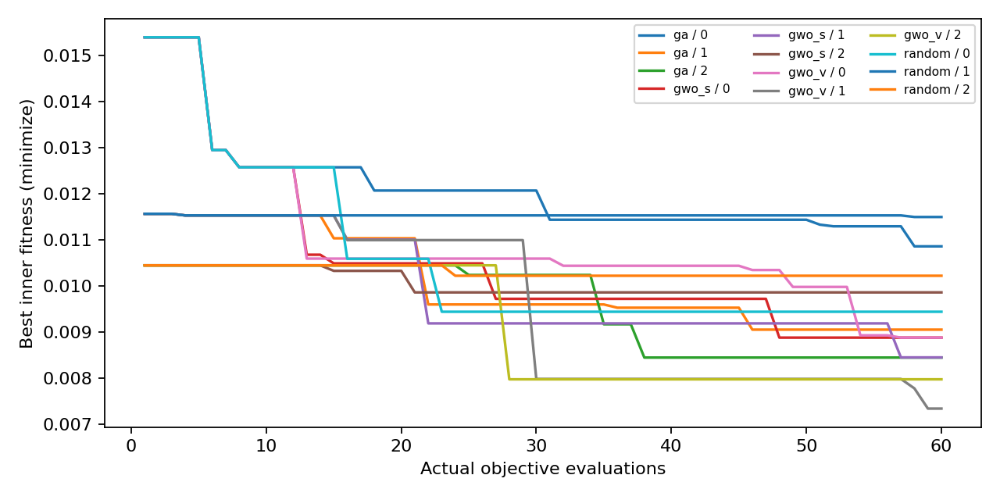
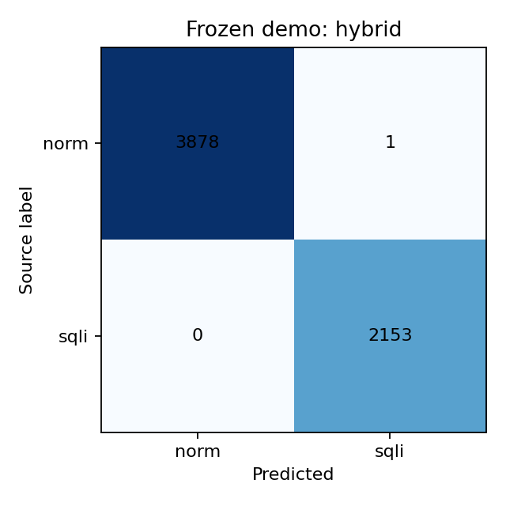

# Measured results

All values below come from saved experiment artifacts.

Demo selected using development only: **hybrid**.

## Development outer CV

| Method | Precision | Recall | F1 mean ± sample SD | FPR | AP |
|---|---:|---:|---:|---:|---:|
| rules | 1.000000 | 0.542602 | 0.703459 ± 0.007700 | 0.000000 | N/A |
| structural | 1.000000 | 0.998965 | 0.999482 ± 0.000173 | 0.000000 | 0.999933 |
| text | 0.999884 | 0.996094 | 0.997985 ± 0.000429 | 0.000065 | 0.999889 |
| hybrid | 1.000000 | 0.999311 | 0.999655 ± 0.000171 | 0.000000 | 0.999934 |
| kbest | 0.998153 | 0.995057 | 0.996602 ± 0.000664 | 0.001036 | 0.999848 |
| ga | 1.000000 | 0.995067 | 0.997525 ± 0.001757 | 0.000000 | 0.999863 |
| gwo_s | 0.998961 | 0.994837 | 0.996892 ± 0.001746 | 0.000583 | 0.999881 |
| gwo_v | 0.999308 | 0.997470 | 0.998388 ± 0.000723 | 0.000389 | 0.999916 |
| random | 0.999538 | 0.996786 | 0.998159 ± 0.000692 | 0.000259 | 0.999911 |

## One frozen held-out pass

| Method | Precision | Recall | F1 | FPR | AP | TN/FP/FN/TP | Dim |
|---|---:|---:|---:|---:|---:|---|---:|
| rules | 1.000000 | 0.534603 | 0.696731 | 0.000000 | N/A | 3879/0/1002/1151 | 0 |
| structural | 0.999536 | 1.000000 | 0.999768 | 0.000258 | 0.999999 | 3878/1/0/2153 | 20 |
| text | 1.000000 | 0.998142 | 0.999070 | 0.000000 | 0.999978 | 3879/0/4/2149 | 40000 |
| hybrid | 0.999536 | 1.000000 | 0.999768 | 0.000258 | 1.000000 | 3878/1/0/2153 | 40020 |
| kbest | 0.997675 | 0.996749 | 0.997212 | 0.001289 | 0.999967 | 3874/5/7/2146 | 8 |
| ga | 1.000000 | 0.997678 | 0.998837 | 0.000000 | 1.000000 | 3879/0/5/2148 | 7 |
| gwo_s | 0.999534 | 0.995820 | 0.997673 | 0.000258 | 0.999955 | 3878/1/9/2144 | 6 |
| gwo_v | 0.999070 | 0.997678 | 0.998373 | 0.000516 | 0.999933 | 3877/2/5/2148 | 5 |
| random | 0.999535 | 0.997678 | 0.998605 | 0.000258 | 0.999985 | 3878/1/5/2148 | 8 |

## Cost and seed variation

Each search has 60 objective calls; each nonempty call fits three LRs.
12 outer + 12 full-development searches use 1,440 objective calls.
Nonsearch methods do not incur those costs. Final scoring performs no fits.

| Method | Outer fits | Search s | Full-dev fits | Fitness seeds 0/1/2 | Features |
|---|---:|---:|---:|---|---:|
| rules | 0 | 0.000 | 0 | N/A | 0 |
| structural | 3 | 0.000 | 1 | N/A | 20 |
| text | 3 | 0.000 | 1 | N/A | 0 |
| hybrid | 3 | 0.000 | 1 | N/A | 20 |
| kbest | 3 | 0.000 | 1 | N/A | 8 |
| ga | 543 | 24.204 | 541 | 0.010858/0.009051/0.008446 | 7 |
| gwo_s | 543 | 24.048 | 541 | 0.008878/0.008449/0.009859 | 6 |
| gwo_v | 543 | 24.821 | 541 | 0.008878/0.007339/0.007973 | 5 |
| random | 543 | 24.085 | 541 | 0.009439/0.011494/0.010220 | 8 |

Masks, seed counts, metrics, timings, CSR bytes and strata are in `results/`.
CSR bytes measure buffers, not peak RAM. Folds/seeds are correlated;
SD is descriptive and no statistical significance or deployment effectiveness is claimed.

## Development grouping stress test

Primary groups: 24124; stress groups: 14998. Stress-group overlap in primary outer folds: [416, 420, 400].
- hybrid: stress-disjoint F1 0.999049 ± 0.000754.
- structural: stress-disjoint F1 0.999003 ± 0.000694.
- text: stress-disjoint F1 0.989559 ± 0.005820.

The heuristic merges strings aggressively and is not a source-separated holdout.
No primary duplicates: representative-group metrics equal row metrics.
Benign CSIC values and sqlmap-generated SQLi remain source-confounded. High scores are
not evidence of generalization to deployed attacks. The rule baseline's misses and every
optimizer's unfavorable comparisons are retained. False positives use aggregate
length/encoding/keyword strata only; no third-party payloads are republished.

## Measured fitting, inference and memory

| Method | Full-dev fit s | Held-out batch ms/item | Single-item ms | Held-out matrix bytes |
|---|---:|---:|---:|---:|
| ga | 0.661585 | 0.035998 | 0.468168 | 337792 |
| gwo_s | 1.495723 | 0.024603 | 0.384060 | 289536 |
| gwo_v | 1.802181 | 0.034713 | 0.441303 | 241280 |
| hybrid | 6.871631 | 0.172141 | 2.065471 | 8756004 |
| kbest | 0.932082 | 0.030235 | 0.613354 | 386048 |
| random | 1.837393 | 0.041280 | 0.368116 | 386048 |
| rules | 0.000075 | 0.002210 | 0.001852 | 0 |
| structural | 0.774966 | 0.034917 | 0.597353 | 965120 |
| text | 4.703642 | 0.133463 | 0.734398 | 7597860 |

These are local wall-clock measurements. The memory column counts transformed buffers;
it excludes vocabulary, model, temporary allocations and peak RSS. Single-item inference
uses the first up to 100 partition values; it is not a production benchmark.

## Frozen structural masks

| Method | Selected feature names |
|---|---|
| ga | length, single_quotes, equals, dash_comments, hashes, sql_keywords, non_ascii_ratio |
| gwo_s | space_ratio, punctuation_ratio, parentheses, equals, dash_comments, sql_keywords |
| gwo_v | punctuation_ratio, single_quotes, hashes, sql_keywords, boolean_keywords |
| random | length, digit_ratio, punctuation_ratio, equals, dash_comments, block_comments, hashes, boolean_keywords |

## Error strata for the preselected demo

| Stratum | Rows | FP | FN |
|---|---:|---:|---:|
| keyword | 1573 | 0 | 0 |
| length_21_100 | 1856 | 0 | 0 |
| length_gt_100 | 769 | 0 | 0 |
| length_le_20 | 3407 | 1 | 0 |
| no_keyword | 4459 | 1 | 0 |
| no_percent_encoded | 6032 | 1 | 0 |
| percent_encoded | 0 | 0 | 0 |

Strata overlap; counts must not be summed across them. No raw held-out values were
inspected to choose thresholds, change the model, or classify error examples. All methods’
strata are preserved in `results/final/metrics.json`. The single hybrid false positive
shows that even this favorable benchmark does not justify blocking real requests.

The held-out percent-encoded stratum is empty, so this study provides no measured
encoded-payload generalization evidence. Constant ANOVA columns were reported
rather than hidden. Finite search can retain an uninformative feature (for example,
GA's non-ASCII ratio and RandomSearch's block-comment count); selected count does
not mean every retained variable has predictive value. AP near one does not imply
zero false positives at the predeclared probability threshold, which remains 0.5.
The tiny outer F1 difference between hybrid and structural is not a significance
claim; the much larger hybrid representation should be considered when interpreting
its development-only selection.
